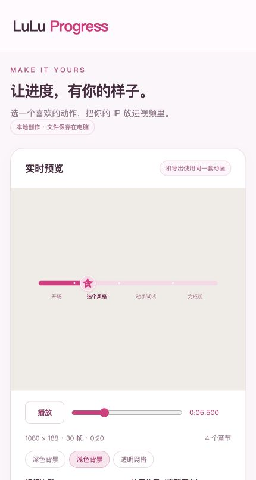

# LuLu Progress

**把自己的头像，变成视频里的进度标记。**

提供连续滑动、章节跳跃、分段填充三款头像主题；支持换头像、双表情、颜色、大小、粗细、位置和字幕章节。既可由 AI 通过 Skill 制作，也可打开本地编辑器实时调整。



## 两种使用方式

### 通过 AI Skill

将完整项目交给支持本地文件和执行代码的 AI，读取 SKILL.md 后说：

> 用 lulu-progress 给附件字幕制作章节进度条。先展示三款头像主题，让我选择；根据字幕内容整理章节，确认视频总时长，再预览并导出透明素材。

仅保存 SKILL.md 不包含渲染能力。一个项目副本不等于已经注册到 AI 工具的技能目录；安装方式取决于所用工具。

### 本地可视化编辑器

安装 Node.js 22 或更高版本（本项目实测 Node.js 24），以及 pnpm。在项目目录运行：

```sh
pnpm install --frozen-lockfile
pnpm editor
```

用浏览器打开终端显示的 `http://127.0.0.1:4318`。

1. 选择连续滑动、章节跳跃或分段填充。
2. 上传 PNG / JPG / WebP 头像；可额外上传另一种表情，章节切换时交替显示。图片采用圆形裁切，不自动抠背景。
3. 导入 SRT / VTT，核对视频实际时长，修改章节。页面按较长停顿提供初步时间点，标题是占位词；这不等于 AI 语义分章。需要按内容归纳时，将字幕交给使用本 Skill 的 AI。
4. 调整颜色、头像大小和条带粗细，拖动播放进度查看不同时间点。预览背景不会进入输出。
5. 选择紧凑或完整画布、MOV 或 WebM，点击导出。生成完成后下载视频与配置。

头像上传、配置和视频保存在本地项目中；服务只监听本机。页面可选项仅支持三款头像主题，上游六款经典主题仍可通过 Remotion Studio 或配置调用。

## 三款头像主题

| 主题 | 特点 |
| --- | --- |
| 连续滑动 `lulu` | 按真实时间前进，节点与章节时间成比例；头像中心与条带对齐 |
| 章节跳跃 `lulu-hop` | 等宽章节格，进入新章时跳到该格中心 |
| 分段填充 `lulu-cells` | 等宽章节格，当前格内按本章时长推进 |

自动文字排版会检查实际章节空间，拥挤时只显示当前章。可以选择始终显示所有章节或只显示当前章。

## 导出与剪辑

- **MOV / ProRes 4444**：带透明通道，作为剪辑素材；体积较大。实际编辑软件兼容性请以导入测试为准。
- **WebM / VP9 alpha**：可选轻量透明素材；部分剪辑软件可能不支持。不要假定手机剪映或所有桌面软件都支持。
- **紧凑模式**：只导出条带区域，减少空白画布。放到主视频上方轨道后，手动移到顶部或底部。
- **完整画布**：匹配视频尺寸，按配置放在顶部/底部；与主视频起点对齐。

不要改变素材播放速度或拉伸时长。之后如果剪掉、重排视频内容，需要重新生成对应章节时间。

MOV 也可能仅因播放器不显示透明通道而看起来是黑底。透明效果应通过解码或叠加验证，不需要对透明输出再次做色键抠像。

## 命令行

```sh
# Remotion Studio（含经典样式）
pnpm preview
# 读取字幕，语义归纳仍由 AI 完成
python3 scripts/prepare_subtitles.py examples/sample.srt out/cues.json
# MOV 完整画布
node scripts/export.mjs examples/demo.json out/progress.mov
# 紧凑 MOV
node scripts/export.mjs examples/demo.json out/strip.mov --compact
# 紧凑透明 WebM
node scripts/export.mjs examples/demo.json out/strip.webm --compact
# 检查与行为测试
pnpm check
pnpm test
```

首次渲染可能需要下载 Remotion 的浏览器和编码工具。已有兼容 Chrome 时，可设置环境变量 `REMOTION_BROWSER_EXECUTABLE` 为浏览器可执行文件路径。浏览器下载、运行权限或网络限制导致失败时，编辑器会显示失败信息，不能因此宣称渲染成功。

运行 `pnpm editor` 后修改源码，需要重启本地服务。可以通过环境变量 PORT 更换端口。编辑器是本地工具，没有远程服务器、在线 AI API 或自动付费服务。

## 打包分享

```sh
# 默认公开包：内置星星，不包含个人头像、用户上传和生成视频
python3 scripts/package_skill.py ../lulu-progress-v0.2.0.zip
# 私人使用包：附带本地 LuLu 头像
python3 scripts/package_skill.py ../lulu-progress-personal-v0.2.0.zip --include-brand
```

默认包会从示例配置中去掉头像路径，使用内置通用星星。个人包保留两张 LuLu 图片。导入其他人的配置时，图片也需在本地 public 中存在，或重新上传自己的图片。

## 项目文件

- `SKILL.md`：给 AI 的操作指南
- `src/`：动画与共用时间、布局逻辑
- `editor/`：可视化编辑器
- `scripts/`：本地服务、导出、字幕解析、测试与打包
- `examples/`：三款主题、短测试配置和原创示例字幕
- `references/`：配置字段与安装验证方法
- `public/`：本地头像；上传文件在 public/uploads，默认不进入发布包

## 来源与许可

基于 [keni112403/video-progress-studio](https://github.com/keni112403/video-progress-studio) 修改（参考快照 914a3766645417a67a91722c79e121f9fb6c6249），保留原作者 MIT 版权和许可。新增三款可配置头像主题、本地编辑器、紧凑/轻量导出、测试和打包流程。Remotion 等依赖适用各自许可；使用前请查阅 [Remotion 许可](https://www.remotion.dev/license)。

LuLu 头像为用户提供的品牌素材，不属于代码 MIT 许可，未授予第三方再分发或商业使用权。默认公开包不包含个人头像。原始图片不自动抠图或重绘。
